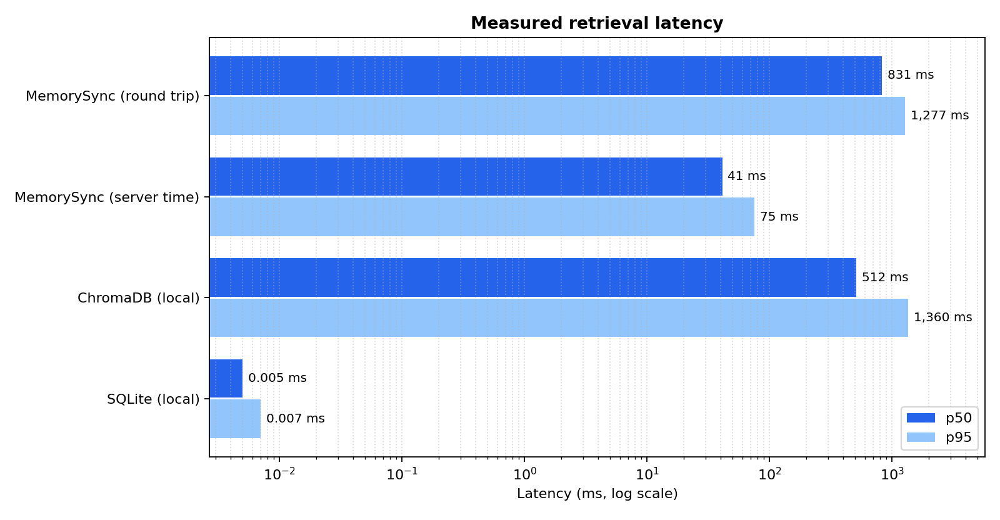

# AI Agent Memory Benchmarks: SQLite, ChromaDB and the MemorySync API

[](LICENSE)
[](https://python.org)

Retrieval latency for three ways an AI agent can keep memory: an in-process
SQLite table, an in-process ChromaDB vector store, and the
[MemorySync](https://memorysync.io) API.

Every number here was measured by `benchmark.py`.
A backend that cannot run is reported as **not run**; the script never fills in
a missing measurement.

---

## Results

| Backend | What one query does | p50 | p95 |
|---|---|---:|---:|
| SQLite, local | Keyword filter on an indexed column. No network, no ranking by meaning. | 0.005 ms | 0.007 ms |
| ChromaDB, local | Embeds the query text on this CPU, then a vector search. | 512 ms | 1,360 ms |
| MemorySync, server time | Hybrid keyword and vector ranking scoped to one end user (`latency_ms` in the response). | 41 ms | 75 ms |
| MemorySync, round trip | Server time plus the network path to the API, on one kept-alive connection. | 831 ms | 1,277 ms |



**These numbers move.** Another run measured MemorySync's
server time at 179 ms p50 and 980 ms p95. Run it yourself, from where your
application runs, before relying on any figure here.

## How to read this

The three backends do different work, so this is a shape rather than a race.

- **In-process stores are microseconds** because nothing leaves the process.
  SQLite here is a keyword lookup; it does not rank by meaning.
- **ChromaDB pays for embedding the query locally.** That cost depends on the
  CPU, and it is paid again in every process that holds the store.
- **Any hosted memory service is dominated by the network** when the client is
  far from it, MemorySync included. What the round trip buys is facts extracted
  from free text, ranking by meaning, isolation per end user, and memory that
  survives the machine and is shared between tools and agents.

If your agent reads memory once per task, a sub-second round trip is usually
small next to model generation. If you need single-digit milliseconds on every
call, keep a local store.

---

## Reproduce

```bash
git clone https://github.com/memorysyncio/memory-benchmarks.git
cd memory-benchmarks
pip install -r requirements.txt
python benchmark.py --iterations 50
```

- **MemorySync** uses `MEMORYSYNC_API_KEY` if it is set. Otherwise it creates a
  free evaluation key with one API call (no signup), stores five facts under a
  scratch end user, waits three seconds, and times the queries.
- `--skip-remote` measures the local backends only. CI uses it, because CI
  runners share IP ranges and a benchmark must not report a number it did not
  measure.
- Output: a table on the console, `results.json`, and
  `assets/measured_latency.png`, all from the same run.

---

## Changes

- Rewritten to report only measured numbers. Earlier versions
  carried a "<50 ms" MemorySync figure, measured an MCP handshake against the
  documentation server rather than a memory query, and drew their charts from
  fixed arrays. Those figures and charts were not measurements, and they have
  been removed.

## Ecosystem

- **LangGraph integration:** [docs.memorysync.io/guides/langgraph](https://docs.memorysync.io/guides/langgraph)
- **LlamaIndex integration:** [docs.memorysync.io/guides/llamaindex](https://docs.memorysync.io/guides/llamaindex)
- **Cursor starter:** [github.com/memorysyncio/memorysync-cursor-starter](https://github.com/memorysyncio/memorysync-cursor-starter)

## License

MIT © [MemorySync](https://memorysync.io)
